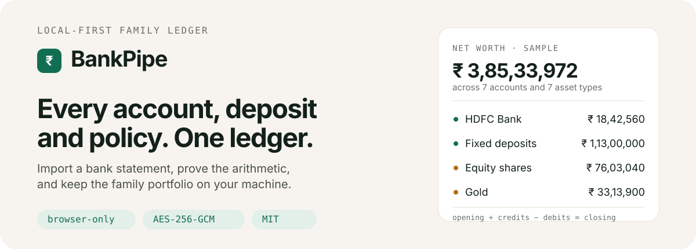
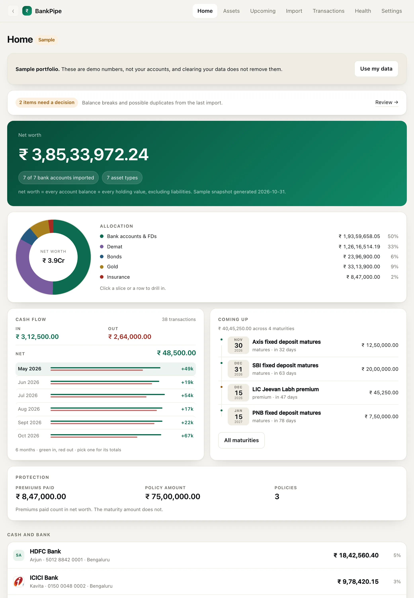
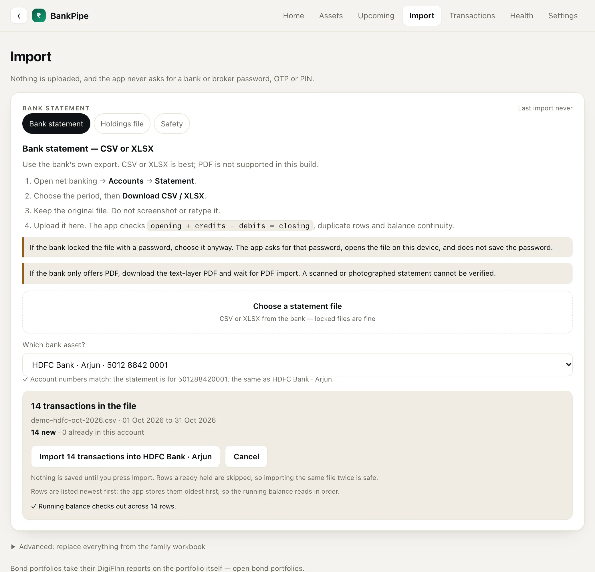
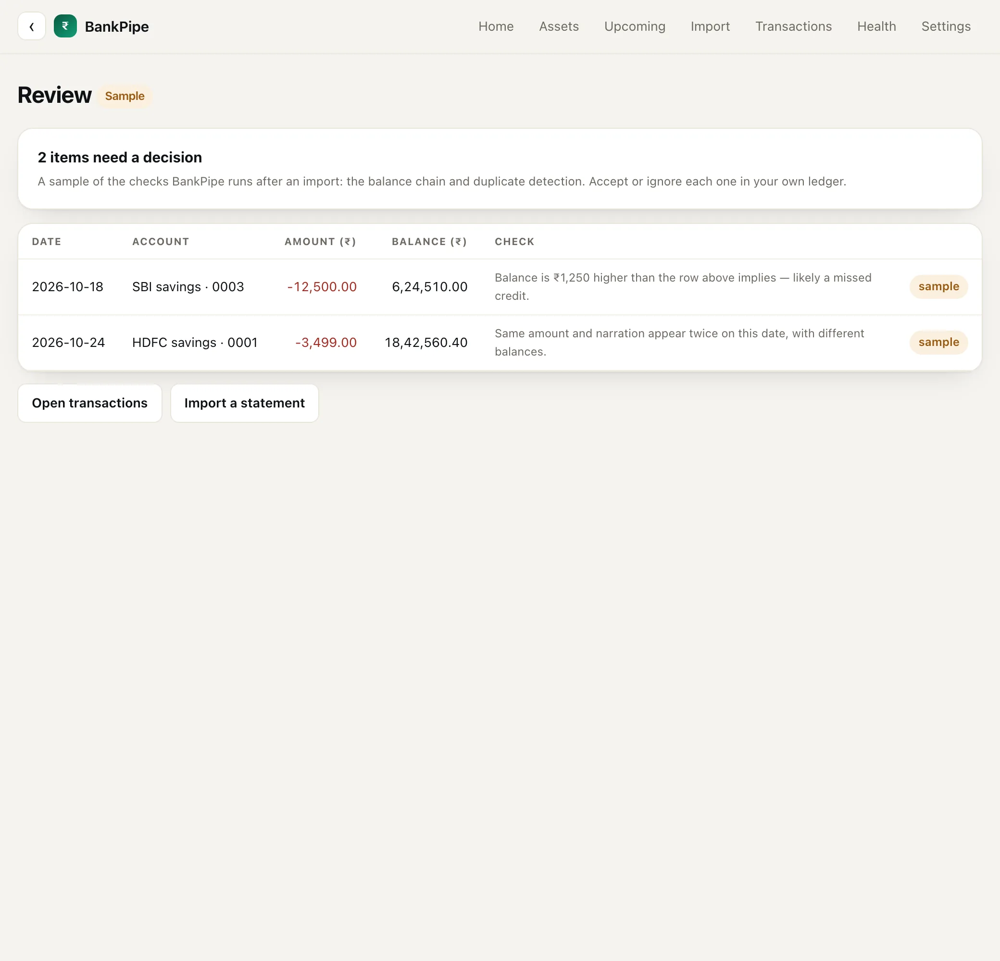
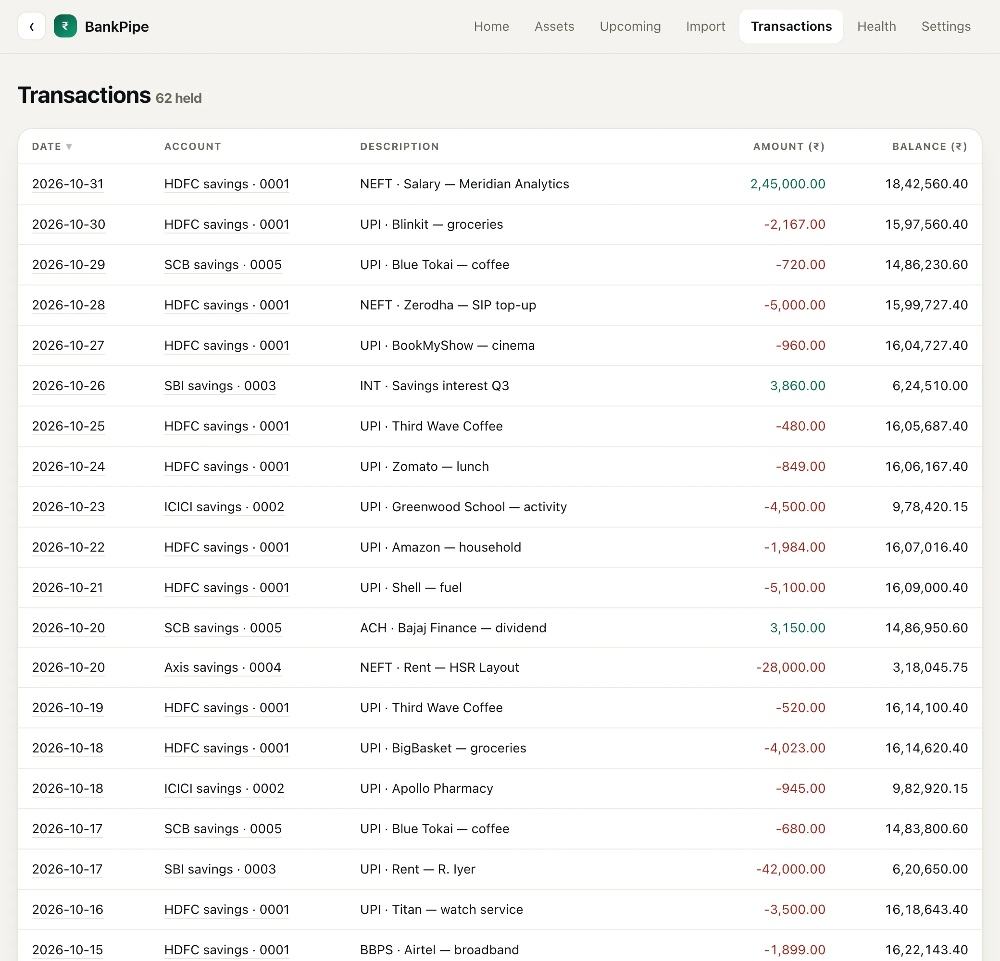
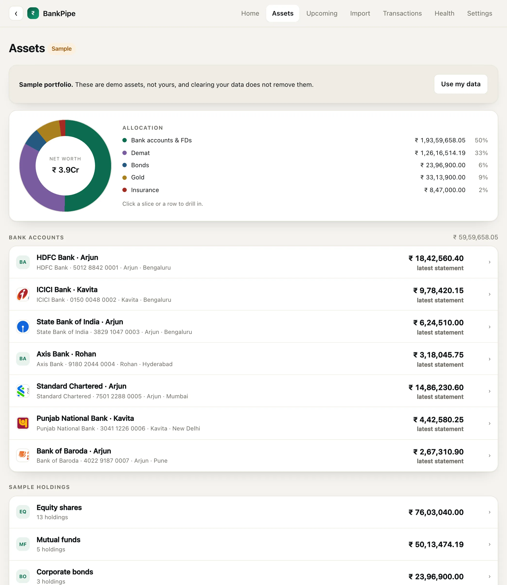
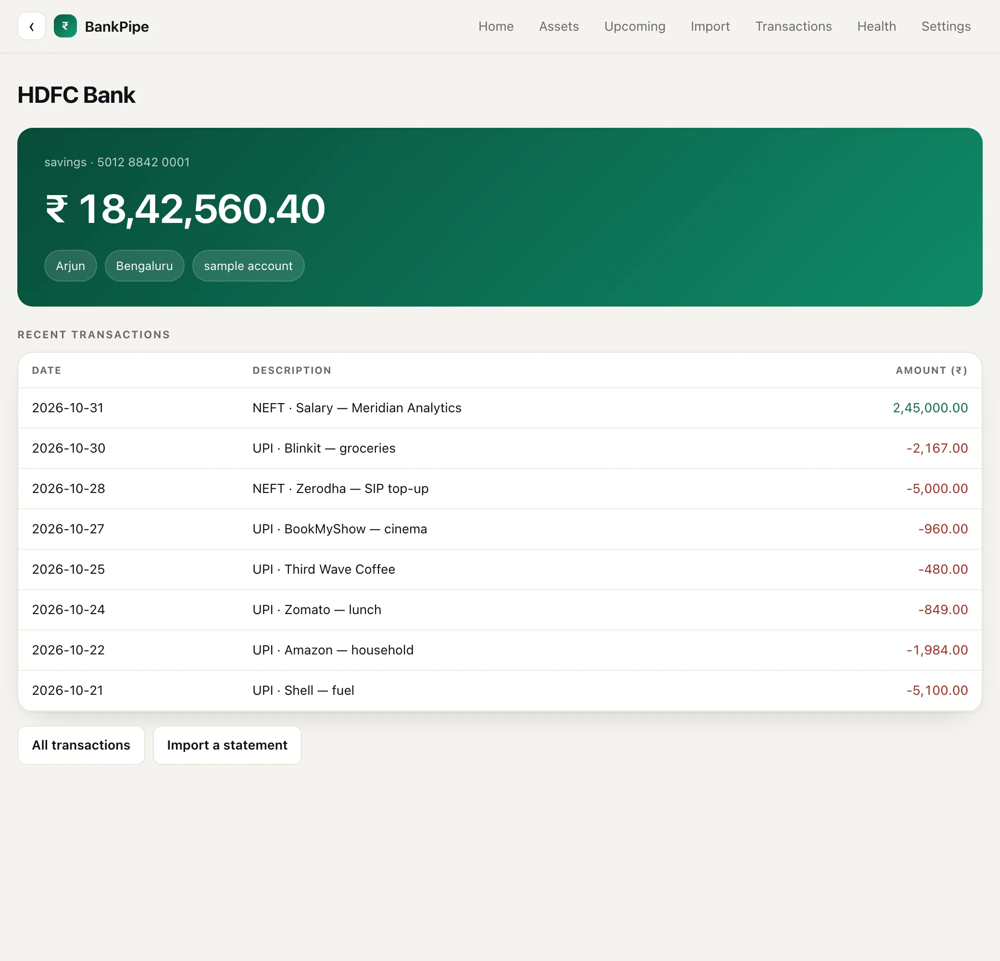
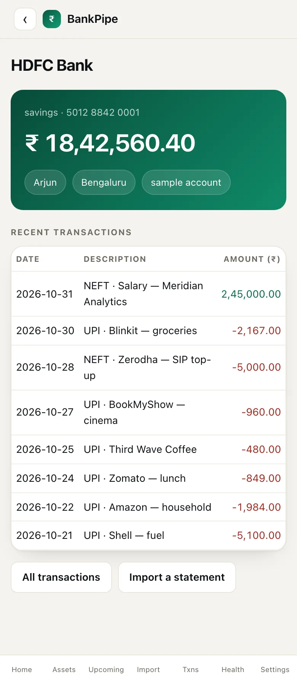

<p align="center">
  
</p>

<p align="center">
  <b>A family finance ledger that can prove its own arithmetic.</b><br>
  Import the statement your bank already gave you. The preview checks the running balance.<br>
  Nothing is uploaded to us. The ledger is encrypted at rest.
</p>

<p>
  
  <br>
  <sub><b>The whole portfolio, on one screen.</b> Net worth, allocation, six months of cash flow and the next four maturities — the app itself, rendering the sample portfolio.</sub>
</p>

## What BankPipe is

One local ledger for the bank accounts, deposits, policies and holdings a family
owns. It takes the files banks and brokers export, a family workbook, or a few
fields typed by hand.

## The arithmetic gate

A spreadsheet trusts whoever typed the last cell. Re-import a statement, copy a
running balance wrong, or let two people edit the same file, and the total can drift
while every figure still looks plausible. BankPipe starts from the bank's own export
and makes the arithmetic the gate:

- **`opening + credits − debits = closing`.** The preview checks the statement header,
  the parsed rows and the running-balance chain before you press Import.
- **A file with no recognisable header is refused before a row is written.** A row
  that does not reconcile is still imported, with the break recorded in Review.
- **Importing the same statement twice changes nothing.** A transaction's identity is
  its account, date, amount, balance and narration, so overlapping periods add only the
  rows that are new.

Newest-first exports are stored oldest-first, so the last row carries the closing
balance. A single-date file is ordered by its running balance, not by file order.

<p>
  
  <br>
  <sub><b>Proof before writing.</b> The account number in the file picks the destination, all 14 rows reconcile, and nothing is saved until you press Import.</sub>
</p>

<p>
  
  <br>
  <sub><b>A row that does not reconcile waits here.</b> Each balance break or possible duplicate carries the date, amount, expected and actual figures, and the reason it was flagged. You accept or ignore it from here.</sub>
</p>

## Inside the ledger

<p>
  
  <br>
  <sub><b>One ledger, every account.</b> Salary, SIPs, rent, groceries and interest in date order, with the balance after each row.</sub>
</p>

<p>
  
  <br>
  <sub><b>The whole balance sheet.</b> Bank accounts and fixed deposits, equity, mutual funds, bonds, gold and insurance, grouped by how the money is actually held.</sub>
</p>

<table>
  <tr>
    <td width="62%" valign="top">
      
      <br><sub><b>Every account has its own page.</b> The latest balance, the transactions behind it and the deposits linked to it.</sub>
    </td>
    <td width="38%" valign="top">
      
      <br><sub><b>Same ledger on a phone.</b> The layout reflows and the numbers stay put.</sub>
    </td>
  </tr>
</table>

## What it tracks

| Asset | What BankPipe keeps | How it gets there |
|---|---|---|
| Bank accounts | balance, statement history, running-balance checks | CSV or XLSX statement, including password-protected XLSX |
| Fixed deposits | principal, rate, start, maturity, linked account | family workbook, auto-matched to a bank account, or by hand |
| PPF | balance, start, maturity | family workbook or by hand |
| Equity and mutual funds | quantity, invested and current value | broker holdings, family workbook or by hand |
| Bonds | ISIN, coupon, maturity, rating, cashflow | DigiFInn reports, ratings CSV, manual lots |
| Gold | grams, buy price and current price per gram | by hand |
| Insurance | policy, cover, premium, maturity | family workbook or by hand |
| Cash, property, other | balance or value, and notes | by hand |

The home page adds it up as **net worth = every account balance + every holding
value**. Gold counts at cost, with its market value and unrealised gain shown
separately. Insurance counts premiums paid, not the cover. Liabilities sit outside
the figure on purpose: this is a ledger of what the family owns, not an accounting
system.

## What stays on your machine

BankPipe is a static page. There is no BankPipe server, no account, no telemetry and
no upload path to the author.

- The ledger is SQLite (sql.js) in the browser, sealed with **AES-256-GCM** before it
  reaches IndexedDB. The key is derived from your passphrase with
  **PBKDF2-HMAC-SHA256, 600,000 iterations**.
- Google Drive backup is optional. A manual snapshot is gzip-compressed, encrypted with
  a random data key and uploaded as one file. The automatic copy is split into fixed
  64 KiB blocks; a block whose bytes have not changed keeps its name and is not uploaded
  again. The passphrase never leaves the device. Google sees file names, sizes,
  timestamps and ciphertext. The format and the restore path are in
  [BACKUP.md](./BACKUP.md).
- Diagnostics are shape-only: column positions, counts and value shapes, never amounts,
  names or account numbers.
- Three network calls exist: the optional Google Drive backup, an IFSC lookup
  (`ifsc.razorpay.com`) when you add a branch, and BSE/SMEST bond lookups on the local
  server. All three are visible in the source.

`web/server.mjs` is a local static server plus those two price routes. It is not a
backend for your data.

## Run it

```bash
git clone https://github.com/shivam2014/bankpipe.git
cd bankpipe
./launch.sh
```

`launch.sh` serves `web/` on the first free port from 8765 and opens it. Anywhere
Node.js runs, you can skip the script:

```bash
node web/server.mjs
# http://127.0.0.1:8801/
```

There is no build step to run the app, no npm install and no package manifest; Node.js
is the only requirement. The two browser libraries the app uses, sql.js and SheetJS,
are vendored in `web/vendor/`.

Open **`/?demo=1`** for the sample portfolio shown in the screenshots. Every name,
account number and amount in it is invented.

### Your first import

1. Download the statement as CSV or XLSX from net banking (**Accounts → Statement**).
   Keep the original file; do not screenshot or retype it.
2. Open **Import → Bank statement** and choose it. The account number in the preamble
   picks the destination; if it does not match, the app shows both numbers and asks.
3. Read the preview: date range, rows ready, rows already held, and the running-balance
   result. Press **Import** only when those are right.
4. Anything that does not reconcile lands in **Review** with the figures. **Health**
   shows the state of every account.

## Tests

```bash
cd web && node --test
```

391 tests cover statement parsing, date and amount formats, reconciliation, duplicate
detection, encryption, backup and restore, bond maths, holdings import, and the local
server's refusal to serve private files.

Some fixtures began as real export shapes. Account numbers, names, addresses, phone
numbers and ID numbers were replaced with made-up values; amounts and layouts were
left alone so the arithmetic and date-format cases stay realistic.

The optional Drive broker in `worker/` has its own suite: `cd worker && node --test`.

## Limits

- **PDF bank statements are not supported yet.** CSV and XLSX are the reliable path; a
  text-layer PDF reader is the next import. Scanned statements need OCR before a parser
  can trust them.
- **Demat CAS is not built.** The bond and equity importers cover the current workflow;
  the design for CAS import is in [DEMAT_INTEGRATION.md](./DEMAT_INTEGRATION.md).
- **The hosted build cannot fetch bond prices.** BSE and SMEST lookups need the local
  server, so those buttons appear only on `127.0.0.1`, `localhost` or `[::1]`.
- **It is a family ledger, not tax or investment advice.** Figures are gross unless a
  screen says otherwise; TDS is not modelled on bond cashflows.
- **One browser, one ledger.** Drive backup moves a sealed copy; it is not multi-user
  sync.

## Project layout

| Path | What it is |
|---|---|
| `web/` | the app: UI, storage, parsers, crypto and their tests ([notes](./web/README.md)) |
| `web/server.mjs` | zero-dependency static server and local price routes |
| `web/fixtures/` | scrubbed statement fixtures used by the tests |
| `docs/UI-REVIEW.md` | running UI issue log |
| `BACKUP.md` | backup format, restore path and failure modes |
| `DEMAT_INTEGRATION.md` | proposal for CAS import, not built |
| `worker/` | OAuth broker for the optional Drive backup |
| `site/`, `scripts/` | landing page and the Cloudflare Pages build |

## Contributing

Issues and pull requests are welcome. Run `cd web && node --test` before opening a PR.
If you are changing a parser, add a fixture and a test that fails on the old code first.
`./check-no-data.sh` is the gate against real data: it fails on a data file anywhere
in the tree, or on a real identifier in a fixture, test or doc. Do not commit
statements, account numbers or personal data.

## License

MIT. See [LICENSE](./LICENSE).
