# Architecture

BankPipe is a static web app with no data backend. The browser parses, verifies, stores,
encrypts and renders the ledger. Two small services exist for reasons a browser cannot
satisfy: a static host, an OAuth token broker, and an optional local proxy for exchange
prices.

This page explains the runtime shape. The diagrams are SVG, rendered from the Mermaid
sources in [`diagrams/`](./diagrams). The schema and module diagrams are generated from
source. The flow diagrams are authored, because they describe intent a generator cannot
infer. CI renders and checks all of them on every commit. The mechanics are in
[`README.md`](./README.md).

## What runs where

Plaintext lives on the device. The browser tab owns the ledger. IndexedDB holds the
sealed database. The local Node server is optional and serves files plus two price
routes. Cloudflare Pages serves static files; a Worker exchanges Google OAuth codes for
tokens and never sees ledger bytes. Google Drive receives ciphertext.

The precise claim is **no BankPipe data backend**, not "no servers". The three network
calls are the optional Drive backup, an IFSC lookup, and BSE/SMEST on the local server.

## Browser runtime

SQLite runs in WebAssembly through sql.js. The working database lives in memory.
Persistence is explicit: `store.export()` returns the whole SQLite file, which is sealed
with the database passphrase (PBKDF2-HMAC-SHA256, 600,000 iterations, AES-256-GCM) and
written as one blob to IndexedDB. Unlock reads the blob, derives the key, decrypts, and
constructs a new `SQL.Database(bytes)`.

The passphrase is never stored. `lockDb()` closes the connection and drops the reference.
A save hook wakes the automatic backup scheduler after every write.

There is no service worker, so there is no offline install or background sync.
`localStorage` holds preferences, the demo flag, a device id and backup timestamps. The
sample portfolio never enters SQLite.

Code: [`web/db.js`](../web/db.js), [`web/dbatrest.js`](../web/dbatrest.js),
[`web/crypto.js`](../web/crypto.js).

## Import pipeline

1. **Read.** CSV uses a small quoted-field reader, XLSX uses SheetJS, and PDF reads the
   text layer through pdf.js. A scanned PDF is refused rather than guessed at.
2. **Find the shape.** The header is the row in the first 40 that matches the most column
   synonyms, not line 1 by assumption. The preamble above it supplies the account number
   and IFSC. File order is detected from dates, or from the running balance when every
   row shares one date.
3. **Verify.** Every row's balance must follow from the previous balance plus its amount,
   within one paise. With dates, the check is per day so repeated end-of-day balances do
   not invent breaks. The printed closing figure must equal the last running balance.
4. **Decide.** `planImport` is one function used by both the preview and the write. It
   returns a per-row decision: insert, skip, or correct.
5. **Commit.** One import writes an `import_run`, the new `fact` rows, and an `issue` for
   anything that does not reconcile.
6. **Review.** A break is imported and flagged with expected and actual figures. Only
   files that cannot be read are refused before writing.

Idempotency has two layers. A row's identity is date, amount, running balance and
normalised narration, with an occurrence counter for genuinely identical rows. The write
also stores a `UNIQUE txn_key` built from the same fields. Re-importing an overlapping
statement adds only the rows that are new.

Money is integer paise everywhere. Unreadable money is `null`, never zero.

Code: [`web/parse.js`](../web/parse.js), [`web/ledger.js`](../web/ledger.js),
[`web/db.js`](../web/db.js).

## Ledger schema

The two diagrams below are generated from `web/db.js`. They show primary keys, foreign
keys, unique keys and the fields that carry the business meaning. Every column, including
the ones `migrate()` adds in place, is in [`web/db.js`](../web/db.js).

Invariants:

- money is integer paise;
- `null` is not zero;
- `txn_key` is unique;
- `source_row` is the physical line in the file, while `chain_seq` is the position in the
  running-balance chain;
- issues are re-derived on re-check, while accepted and ignored decisions are preserved;
- `import_run` records which file produced which rows.

`account` is the asset container for bank accounts, deposits, demat, bonds, gold, cash,
insurance and property. That keeps net worth a single union rather than unrelated tables.

## Google Drive

A browser cannot keep a client secret, and a refresh token in `localStorage` is readable
by any XSS. The broker holds both. It creates a PKCE verifier and a random `state`, seals
them in an `HttpOnly; Secure; SameSite=Lax` cookie, exchanges the one-time code, and seals
the refresh token in a second cookie. The app asks `POST /token` for a short-lived access
token and calls Drive directly.

Scope is `https://www.googleapis.com/auth/drive.file`: the app sees only files it created.
Google sees file names, sizes, timestamps and ciphertext. The broker never sees ledger
bytes.

Code: [`web/drive.js`](../web/drive.js), [`worker/src/index.js`](../worker/src/index.js),
[`worker/src/lib.js`](../worker/src/lib.js).

## Backup

A random 32-byte data key encrypts every snapshot and every block. The passphrase-derived
key wraps that data key in `vault-key-0001.bpk`, so changing the passphrase rewrites one
small file instead of the archive.

A manual snapshot is gzipped, encrypted, uploaded as one immutable file, downloaded again,
decrypted and compared by SHA-256. Restore decrypts, runs `PRAGMA integrity_check`, counts
rows, and only then replaces the local database.

The automatic copy splits SQLite into fixed 64 KiB blocks named
`HMAC-SHA256(data key, block)`. The name is the content, so an unchanged block is already
in the folder and is not uploaded. New blocks are read back and verified, then the
encrypted manifest is written as the commit point. Garbage collection runs only after the
manifest is read back.

Code: [`web/crypto.js`](../web/crypto.js), [`web/vault.js`](../web/vault.js),
[`web/backup.js`](../web/backup.js), [`web/blockbackup.js`](../web/blockbackup.js).

## Core module graph

This graph is generated from the imports among the ten modules that carry the ledger and
backup paths. The UI in `web/index.html` orchestrates parsing and views; it is not drawn
here because it would be a star with every module at the end of an edge.

## Route surface

[`generated/routes.md`](./generated/routes.md) lists every HTTP route the code registers,
including the local server, the OAuth Worker and the Pages worker. A new route fails the
docs check until it has a note.

## Current counts

[`generated/facts.md`](./generated/facts.md) holds the test counts, table count, module
count and route count. It is generated by running both suites, so it cannot drift from
the code.
